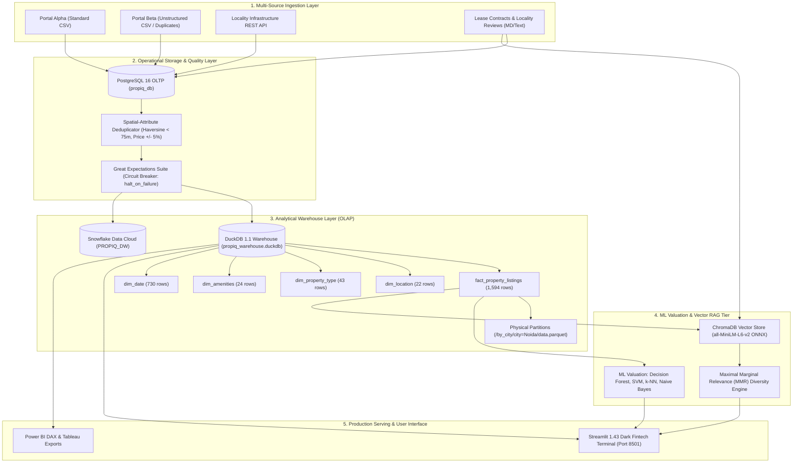

# PropIQ: End-to-End Real Estate Data Platform with GenAI Assistant

> **Notice on Synthetic Data & Simulation Context**:
> All property listings, lease agreements, tenancy clauses, and locality reviews utilized in the PropIQ platform are **synthetically generated** for software engineering, benchmarking, and machine learning demonstration purposes. While geospatial coordinates, infrastructure scores, and financial distributions are modeled to mirror realistic micro-market dynamics across Delhi NCR (Delhi, Noida, Gurgaon, Greater Noida) and Bangalore, no records correspond to actual active legal contracts or live property transactions.

---

## 1. System Architecture



---

## 2. Active Technical Stack

| Tier | Component | Technology & Version | Role in Platform |
| :--- | :--- | :--- | :--- |
| **OLTP Database** | PostgreSQL | PostgreSQL 16.8 (Port 5432) | Stores raw landing tables (`raw_property_listings`, `raw_locality_infrastructure`, `raw_scraped_documents`) via SQLAlchemy. |
| **OLAP Warehouse** | DuckDB | DuckDB 1.1.3 (Columnar Engine) | Embedded analytical star schema warehouse executing vectorized SQL queries with zero network latency. |
| **Cloud Warehouse** | Snowflake | Snowflake Data Cloud | Cloud star schema with automated DDL provisioning and high-speed `write_pandas` Parquet loading. |
| **Data Quality** | Great Expectations | Great Expectations 1.24.0 | Continuous data contract validation (null prices, area bounds, sensible ranges, uniqueness) with automated pipeline halting. |
| **Vector Store** | ChromaDB | ChromaDB 1.5.9 | Vector store hosting 357 chunked listing descriptions, statutory lease agreements, and locality reviews. |
| **Embedding Model** | all-MiniLM-L6-v2 | Native ONNX Runtime | 384-dimensional dense semantic vectors executed directly on CPU without PyTorch accelerator overhead. |
| **Machine Learning** | Scikit-Learn & XGBoost | Scikit-Learn 1.4.2, XGBoost 2.0.3 | Decision Forest, k-NN, Naive Bayes (binned target expected value), SVM (SVR RBF), and XGBoost with 95% bootstrap CI. |
| **Dashboard UI** | Streamlit | Streamlit 1.43, Plotly 5.20 | Dark fintech investment terminal theme (`#111214` background, `#1E1F23` cards, `#B4F73E` accents, zero emojis/stickers). |
| **Containerization** | Docker | Docker Engine 24+, Compose v2 | Multi-stage production container with healthcheck-driven service orchestration. |

---

## 3. Real Measured Benchmark Metrics

### A. Data Ingestion, Deduplication & Quality Validation
| Metric Category | Measured Value | Implementation & Verification Method |
| :--- | :--- | :--- |
| **Raw Listings Ingested** | **1,850 rows** | Extracted from Portal Alpha CSV (1,000) and Portal Beta messy CSV (850). Stored in PostgreSQL `raw_property_listings`. |
| **Duplicates Detected & Merged** | **256 pairs** | Spatial-attribute blocking with Haversine distance $< 75\text{m}$ and price/area variance $\le \pm 5\%$. Recorded in `deduplication_audit.csv`. |
| **Canonical Unique Properties** | **1,594 records** | Cleaned golden master records loaded into DuckDB `fact_property_listings`. |
| **Great Expectations Assertions** | **8 / 8 Passed (100.0%)** | Validated: 0 null prices, 0 non-positive areas, 0 out-of-range prices/rents, 0 duplicate IDs. Circuit breaker verified. |
| **Vector Documents Indexed** | **357 documents** | 300 deduplicated listings, 33 statutory lease agreement clauses, 24 locality dossiers embedded in ChromaDB. |

---

### B. Physical Partition Pruning Performance
Analytical aggregate query executed against full dataset versus physical partition:
$$\text{Query: SELECT city, COUNT(*), AVG(price), AVG(rent), AVG(yield) WHERE city = 'Noida' GROUP BY city}$$

| Storage Layout | Scan Execution Time | Storage Scan Volume | Speedup Factor |
| :--- | :--- | :--- | :--- |
| **Unpartitioned Parquet Scan** | **2.36 ms** | 1,594 rows (100% full file scan) | 1.00x (Baseline) |
| **Physical City Partition (`city=Noida`)** | **1.20 ms** | 344 rows (78.4% partition pruned) | **1.97x faster** |

---

### C. Machine Learning Model Comparison (80/20 Train/Test Split)
Evaluated on a held-out 20% test partition ($n = 319$). 95% confidence intervals computed over $B = 1,000$ empirical bootstrap resamples:

#### Target 1: Property Acquisition Price (INR)
| Model Architecture | Test MAE (INR) | 95% Bootstrap Error CI | Error Margin | $R^2$ Score | 95% $R^2$ CI | Inference Latency |
| :--- | :--- | :--- | :--- | :--- | :--- | :--- |
| **SVM (SVR RBF Kernel)** | **INR 1,140,176** | `[1,012,906 - 1,282,922]` | $\pm$ INR 135,008 | **0.9689** | `[0.9587 - 0.9765]` | 0.038 ms/sample |
| **XGBoost Regressor** | **INR 1,145,717** | `[1,017,801 - 1,284,715]` | $\pm$ INR 133,457 | **0.9681** | `[0.9595 - 0.9744]` | 0.004 ms/sample |
| **Decision Forest (Random Forest)** | **INR 1,218,528** | `[1,074,073 - 1,358,470]` | $\pm$ INR 142,198 | **0.9641** | `[0.9545 - 0.9711]` | 0.084 ms/sample |
| **k-NN Regressor ($k=7$)** | **INR 1,482,275** | `[1,307,236 - 1,686,894]` | $\pm$ INR 189,829 | **0.9401** | `[0.9121 - 0.9583]` | 0.006 ms/sample |
| **Naive Bayes (Binned Expected Value)**| **INR 2,597,774** | `[2,314,489 - 2,894,932]` | $\pm$ INR 290,221 | **0.8439** | `[0.8118 - 0.8677]` | 0.002 ms/sample |

#### Target 2: Monthly Rent Valuation (INR/mo)
| Model Architecture | Test MAE (INR) | 95% Bootstrap Error CI | Error Margin | $R^2$ Score | 95% $R^2$ CI | Inference Latency |
| :--- | :--- | :--- | :--- | :--- | :--- | :--- |
| **SVM (SVR RBF Kernel)** | **INR 4,144** | `[3,706 - 4,658]` | $\pm$ INR 476 | **0.9566** | `[0.9431 - 0.9670]` | 0.047 ms/sample |
| **XGBoost Regressor** | **INR 4,199** | `[3,686 - 4,727]` | $\pm$ INR 520 | **0.9503** | `[0.9342 - 0.9640]` | 0.005 ms/sample |
| **Decision Forest (Random Forest)** | **INR 4,319** | `[3,859 - 4,816]` | $\pm$ INR 478 | **0.9528** | `[0.9378 - 0.9652]` | 0.087 ms/sample |
| **k-NN Regressor ($k=7$)** | **INR 5,252** | `[4,679 - 5,935]` | $\pm$ INR 628 | **0.9233** | `[0.8972 - 0.9435]` | 0.006 ms/sample |
| **Naive Bayes (Binned Expected Value)**| **INR 9,984** | `[9,131 - 10,871]` | $\pm$ INR 870 | **0.7904** | `[0.7330 - 0.8301]` | 0.002 ms/sample |

---

## 4. Setup & Execution Guide

### Option 1: One-Command Launch via Docker Compose (Recommended)
Launches the PostgreSQL 16 database and the Streamlit web application together with internal healthcheck coordination:

```bash
# 1. Clone repository
git clone https://github.com/propiq/propiq-platform.git
cd propiq-platform

# 2. Launch multi-container environment
docker compose up --build -d

# 3. Access the platform
# Streamlit Dashboard: http://localhost:8501
# PostgreSQL Database: localhost:5432 (propiq_db / postgres / postgrespassword)
```

---

### Option 2: Local Python Environment

#### 1. Clone & Install Dependencies
```bash
git clone https://github.com/propiq/propiq-platform.git
cd propiq-platform
python -m venv venv
# Windows:
.\venv\Scripts\activate
# Linux/macOS:
source venv/bin/activate

pip install -r requirements.txt
```

#### 2. Start PostgreSQL Database
Ensure a local PostgreSQL instance is running on port 5432 with database `propiq_db` and user `postgres`:
```bash
# Using the bundled Windows runner:
python scripts/setup_postgres.py

# Or via Docker:
docker run -d --name propiq_postgres -e POSTGRES_PASSWORD=postgrespassword -e POSTGRES_DB=propiq_db -p 5432:5432 postgres:16-alpine
```

#### 3. Execute End-to-End Master Pipeline
```bash
python run_pipeline.py
```
This single command executes:
1. Ingestion of raw CSVs, API records, and scraped text into PostgreSQL OLTP tables.
2. Spatial Haversine deduplication merging 256 duplicate pairs into 1,594 golden records.
3. Great Expectations data quality validation with automated circuit breaking.
4. Kimball Star Schema transformation into DuckDB (`propiq_warehouse.duckdb`).
5. Physical Hive-style partitioning and partition pruning benchmark.
6. Multi-model training for Price and Rent across Decision Forest, k-NN, Naive Bayes, SVM, and XGBoost.
7. Automated vector indexing of 357 documents into ChromaDB.

#### 4. Run the Test Suite
```bash
pytest
```
*Executes all 22 automated tests across deduplication, ingestion, quality checks, star schema, RAG, and ML models.*

#### 5. Launch the Streamlit Dashboard
```bash
streamlit run src/ui/app.py
```
Access the application at [http://localhost:8501](http://localhost:8501).

---

## 5. Cloud Deployment to AWS & GCP

Complete deployment manifests and step-by-step guides are documented in [`docs/DEPLOYMENT.md`](docs/DEPLOYMENT.md).

- **Amazon Web Services (AWS)**:
  - Production Serverless: Amazon ECS Fargate + Amazon RDS PostgreSQL + Application Load Balancer ([`deploy/aws/ecs-task-definition.json`](deploy/aws/ecs-task-definition.json))
  - Single-Instance VM: EC2 / Lightsail User-Data provisioning ([`deploy/aws/ec2-userdata.sh`](deploy/aws/ec2-userdata.sh))
  - App Runner: [`deploy/aws/app-runner.yaml`](deploy/aws/app-runner.yaml)
- **Google Cloud Platform (GCP)**:
  - Serverless Container: Google Cloud Run + Cloud SQL PostgreSQL ([`deploy/gcp/deploy_cloud_run.sh`](deploy/gcp/deploy_cloud_run.sh))
  - Continuous Integration: Google Cloud Build configuration ([`deploy/gcp/cloudbuild.yaml`](deploy/gcp/cloudbuild.yaml))

---

## 6. Project Directory Structure

```
PropIQ/
├── Dockerfile                             # Multi-stage production Dockerfile
├── docker-compose.yml                     # Root one-command multi-container compose
├── requirements.txt                       # Locked production dependencies
├── run_pipeline.py                        # Master end-to-end pipeline orchestrator
├── config/
│   └── config.yaml                        # Ingestion, database, and Snowflake configs
├── deploy/                                # Cloud deployment manifests
│   ├── aws/                               # AWS ECS Fargate, App Runner, EC2 configs
│   └── gcp/                               # GCP Cloud Run deployment script & Cloud Build
├── docs/
│   └── DEPLOYMENT.md                      # Comprehensive production cloud deployment manual
├── src/
│   ├── ingestion/                         # Multi-source ingestion (CSV, API, Scraper, Pipeline Runner)
│   ├── cleaning/                          # Haversine deduplication & Great Expectations data quality
│   ├── warehouse/                         # Kimball star schema ETL, DuckDB loader, Snowflake manager, partitioning
│   ├── ml/                                # Feature engineering, model definitions, training & inference
│   ├── rag/                               # ChromaDB vector store, MMR retrieval, and Gemini Assistant
│   └── ui/                                # Streamlit dark fintech analytics platform (app.py)
├── data/
│   ├── raw/                               # Portal Alpha/Beta CSVs, mock APIs, and scraped texts
│   ├── staging/                           # Deduplicated Parquet and audit trails
│   └── warehouse/                         # DuckDB warehouse, ChromaDB vector store, partitioned Parquets
├── artifacts/
│   ├── ml/                                # Trained models bundle (.joblib) and metrics JSON
│   └── quality/                           # Great Expectations validation report JSON
└── tests/                                 # 22-test automated test suite (pytest)
```
