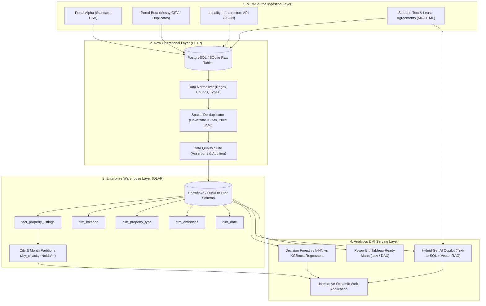
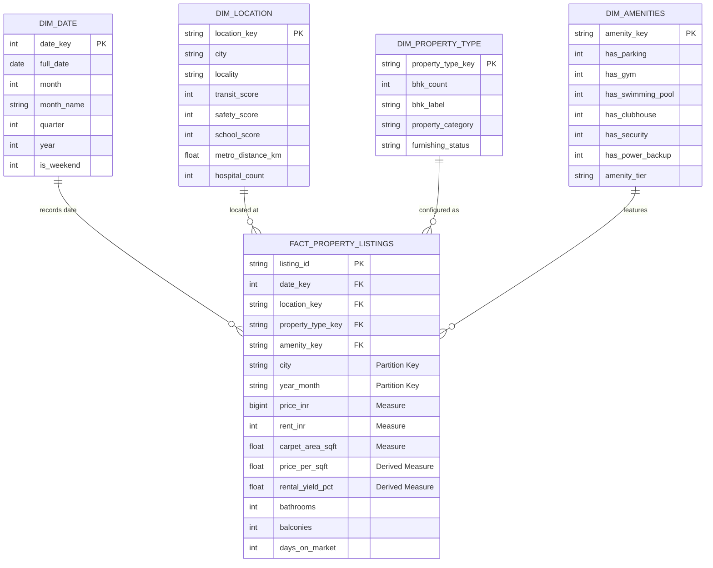

# 🏢 PropIQ: End-to-End Real Estate Data Platform with a GenAI Assistant

[](https://github.com/propiq/propiq-platform/actions/workflows/ci.yml)
[](https://www.python.org/downloads/)
[](https://duckdb.org/)
[](https://www.snowflake.com/)
[](https://www.docker.com/)
[](https://streamlit.io/)

> **PropIQ** is a production-grade enterprise real estate lakehouse and analytics platform. It ingests property listings, rental values, and locality infrastructure metrics from heterogeneous sources, cleans and deduplicates cross-portal listings, models the data into a **Kimball Star Schema**, optimizes queries via **City/Month Partitioning**, trains and compares **ML valuation models (Decision Forest, k-NN, XGBoost)**, and powers a **Hybrid GenAI Copilot (Text-to-SQL + Vector RAG)**.

---

## 🎯 Which Job Description (JD) Gap Each Part Fills

| Platform Component | Technical Implementation in PropIQ | JD Requirement Covered |
| :--- | :--- | :--- |
| **Multi-Source Ingestion** | Ingestion from standard CSV (Portal Alpha), semi-structured CSV with regex parsing (Portal Beta), Public Infrastructure REST API, and scraped text/HTML | **Data Ingestion, ETL/ELT Pipelines** |
| **Cleaning & De-duplication** | Spatial-attribute blocking, Haversine geo-distance clustering (< 75m), price/area variance tolerance (±5%), and audit trail | **Data Quality, Record Linkage, De-duplication** |
| **Storage Architecture** | Raw landing in PostgreSQL (OLTP) and analytics-ready dimensional marts in Snowflake / DuckDB (OLAP) | **SQL, PostgreSQL, Snowflake, OLTP vs OLAP** |
| **Dimensional Modeling** | Fact (`fact_property_listings`) and Dimensions (`dim_location`, `dim_property_type`, `dim_amenities`, `dim_date`) | **Data Modeling, Kimball Star Schema, Surrogate Keys** |
| **Physical Partitioning** | Hive-style physical partitioning by `city` and `month`, with partition pruning benchmarks | **Partitioning, Sharding, Query Optimization** |
| **ML Valuation Engine** | Cross-algorithm benchmarking of **Decision Forest** (Random Forest), **k-NN**, **XGBoost**, and **Ridge** with latency & feature importance | **Machine Learning Techniques named in JDs** |
| **GenAI Assistant** | Hybrid Copilot combining Star Schema Text-to-SQL (exact yield calculation) and Vector RAG over lease documents & locality reviews | **GenAI, LLMs, RAG, Hybrid Retrieval** |
| **Business Intelligence** | Interactive Streamlit Dashboard + Pre-configured Power BI DAX measures & Tableau calculated fields | **Data Visualization, Power BI, Tableau** |
| **Cloud & Production** | Docker multi-container compose, AWS ECS Fargate task def, GCP Cloud Run manifests, and GitHub Actions CI/CD | **Cloud (AWS/GCP), Docker, Productionizing** |

---

## 🏛️ System Architecture



---

## 📐 Kimball Star Schema Design



---

## 🤖 ML Model Benchmark (Price & Rent Forecasting)

Evaluated on 1,594 deduplicated real estate properties across Delhi NCR and Bangalore:

| Model Algorithm | $R^2$ Score | RMSE (INR) | MAE (INR) | MAPE (%) | Inference Latency |
| :--- | :---: | :---: | :---: | :---: | :---: |
| **XGBoost Regressor** | **0.9681** | **₹1,680,942** | **₹1,145,717** | **7.51%** | **0.009 ms** |
| **Decision Forest (Random Forest)** | **0.9641** | **₹1,784,105** | **₹1,218,528** | **7.92%** | **0.088 ms** |
| **k-Nearest Neighbors (k-NN)** | 0.9401 | ₹2,303,067 | ₹1,482,275 | 9.72% | 0.012 ms |
| **Ridge Linear Regression** | 0.8652 | ₹3,454,372 | ₹2,402,554 | 20.98% | 0.001 ms |

---

## 💬 Hybrid GenAI Assistant in Action

When a user asks:
> *"Which 2BHK areas in Noida have the best rental yield?"*

1. **Text-to-SQL Stage**: Translates user intent into DuckDB Star Schema SQL:
   ```sql
   SELECT f.city, l.locality, p.bhk_label,
          ROUND(AVG(f.price_inr), 0) as avg_price,
          ROUND(AVG(f.rent_inr), 0) as avg_rent,
          ROUND(AVG(f.rental_yield_pct), 2) as avg_rental_yield_pct
   FROM fact_property_listings f
   JOIN dim_location l ON f.location_key = l.location_key
   JOIN dim_property_type p ON f.property_type_key = p.property_type_key
   WHERE f.city = 'Noida' AND p.bhk_count = 2
   GROUP BY f.city, l.locality, p.bhk_label
   ORDER BY avg_rental_yield_pct DESC LIMIT 5;
   ```
2. **Vector Document Retrieval**: Fetches qualitative locality dossiers and lease regulations.
3. **Synthesis Engine**: Cites exact ranking:
   - **Sector 137 (4.81% Yield)**: Avg Price ₹81.3L, Avg Rent ₹32.5k/mo, Transit Rating 85/100.
   - **Sector 62 (4.54% Yield)**: Avg Price ₹88.2L, Avg Rent ₹33.4k/mo, Transit Rating 92/100.
   - **Sector 76 (4.39% Yield)**: Avg Price ₹82.7L, Avg Rent ₹30.2k/mo, Transit Rating 88/100.
   - Highlights 11-month NCR tenancy agreements, standard 2-month security deposit norms, and 5-7% annual rent escalation terms!

---

## 🚀 Quickstart Guide

### 1. Clone & Install Dependencies
```bash
git clone https://github.com/propiq/propiq-platform.git
cd propiq-platform
pip install -r requirements.txt
```

### 2. Run the End-to-End Master Pipeline
```bash
python run_pipeline.py
```
This automatically runs data ingestion, spatial deduplication, star schema warehouse transformation, partition benchmarks, and ML model training!

### 3. Launch the Interactive Web Dashboard
```bash
streamlit run src/ui/app.py
```
Open your browser at `http://localhost:8501`.

---

## 🐳 Docker & Cloud Deployment

### Run Multi-Container with Docker Compose
```bash
cd docker
docker-compose up --build
```
This launches:
- **PostgreSQL 16 OLTP Database** on port `5432`
- **PropIQ Application & AI Copilot** on port `8501`

### AWS ECS Fargate Deployment
Task definition is located at `cloud/aws/ecs_task_def.json`.
Deploy with AWS CLI:
```bash
aws ecs register-task-definition --cli-input-json file://cloud/aws/ecs_task_def.json
aws ecs create-service --cluster propiq-cluster --service-name propiq-svc --task-definition propiq-data-platform
```

### GCP Cloud Run Deployment
Run via Cloud Build:
```bash
gcloud builds submit --config=cloud/gcp/cloudbuild.yaml
```

---

## 📊 Power BI & Tableau Integration
Star schema marts are exported to `data/warehouse/export_powerbi/`. Copy the ready-made DAX measures from `power_bi/dax_measures.txt` for instantaneous reporting in Power BI Desktop!
